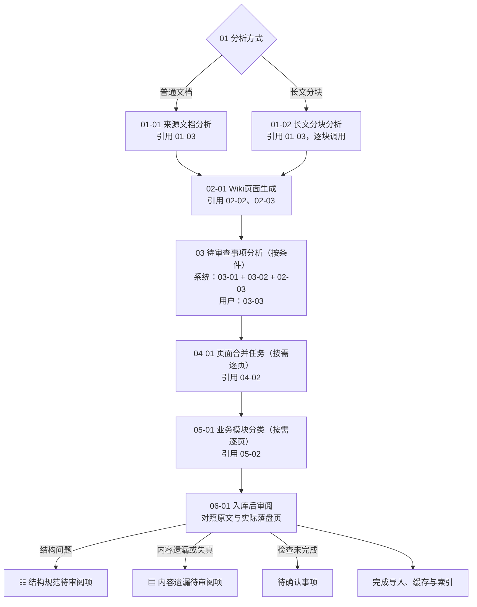

# 入库提示词配置

项目根目录的 `prompts/` 保存自动入库使用的提示词。已有分析、生成、合并等阶段保留原有默认文案；生成和合并完成后检查结构与内容覆盖，将发现的问题全部转为待审阅项，用户可以自定义审阅规则。

## 按调用阶段排列文件

文件采用“阶段序号-阶段内序号-实际用途”的命名方式，按名称升序即可从上到下查看：

```text
01-01-来源文档分析.md
01-02-长文分块分析.md
01-03-独立成页与名称复用规则.md
02-01-Wiki页面生成.md
02-02-独立页面写作规则.md
02-03-研究搜索词生成规则.md
03-01-待审查事项分析.md
03-02-待审查事项筛选规则.md
03-03-待审查事项分析请求.md
04-01-页面合并任务.md
04-02-页面内容合并规则.md
05-01-业务模块分类.md
05-02-业务模块选择规则.md
06-01-最终验收规则.md
06-02-验收修复补录规则.md
```

`01` 文档分析 → `02` 页面生成 → `03` 待审查事项 → `04` 页面合并 → `05` 业务模块分类 → `06` 入库后审阅。

序号表示首次使用的阶段和阅读顺序，不代表每个文件单独调用模型。同阶段可能是二选一、主提示词与嵌入规则，或同一次请求中的系统消息与用户消息。`02-03` 在页面生成时首次使用，独立审查也会复用。

## 提示词调用流程

下图描述未命中入库缓存时可配置提示词的使用顺序；“按条件”或“按需”的阶段可以跳过。图片描述仍使用原有内置提示词，不读取项目提示词文件，也不参与编号。



### 每次模型请求如何组装

表中序号对应上面的完整文件名。原文、分析结果和字典是运行时输入；FILE / REVIEW / JSON 等固定输出协议直接写在模板中。

| 阶段 | 提示词文件如何配合 | 同时传入的材料 | 模型输出 |
| --- | --- | --- | --- |
| `01` 普通分析 | 系统消息以 `01-01` 为框架，在 `{{独立成页与名称复用规则}}` 处插入 `01-03` | 来源原文、来源身份、可用的目录背景、schema、purpose 和索引 | 一份来源分析结果 |
| `01` 长文分析 | 系统消息以 `01-02` 为框架，默认在 `{{独立成页与名称复用规则_列表}}` 处插入 `01-03`；每个分块调用一次 | 当前块、重叠上下文、先前摘要和项目上下文 | 当前块分析和更新后的全局摘要 |
| `02` 页面生成 | 系统消息采用 `02-01`，插入 `02-02` 的写作规则和 `02-03` 的搜索词规则 | 分析结果、来源内容、schema、purpose、索引、overview 和来源身份 | FILE 块及可选 REVIEW 块 |
| `03` 独立审查 | 系统消息采用 `03-01`，插入 `03-02` 和复用的 `02-03`；用户消息采用 `03-03` | 来源内容、分析结果、生成内容、purpose 和索引 | REVIEW 块，无需审查时可不输出 |
| `04` 正文合并 | 系统消息采用 `04-01`，插入 `04-02` 的整合规则 | 已有页面、新生成内容及各自来源信息 | 合并后的完整页面 |
| `05` 模块分类 | 系统消息采用 `05-01`，插入模块字典和 `05-02` | 最终页面标题与正文 | `moduleIds` 数组 |
| `06` 入库后审阅 | 系统消息采用 `06-01` | 来源原文、实际落盘页、schema、purpose 和真实页面路径清单 | `summary`、`issues` JSON，转为待审阅项 |

`06-02-验收修复补录规则.md` 仅保留兼容文件，不再用于自动补录或再次检查。

`01-03`、`02-02`、`02-03`、`03-02`、`04-02`、`05-02` 是嵌入规则，不独立触发模型调用；只有模板保留相应变量时，才使用对应文件内容。

### 哪些提示词会跳过或重复使用

- 正常情况下，普通分析 `01-01` 和长文分块分析 `01-02` 二选一。若普通分析输出达到上限，丢弃不完整响应，自动转入 `01-02` 分块恢复；不能仅凭原文能放进上下文就认为分析输出足够。长文每块携带先前摘要，成功后直接进入 `02-01`。
- 分块分析输出仍截断时，仅将当前片段按语义边界继续细分，最多细分 4 级，目标片段不小于 1,000 字符。仍不能完成时明确失败并保留已完成的分块断点，不无限重试、不使用截断结果生成页面；重试时从分块断点继续。对于原文原本能放入预算的来源，恢复后生成阶段仍提供完整原文。
- `02-01` 本身可以生成审查建议。生成正常完成后，内容达到 10,000 字符、包含至少 4 个 FILE 标记或出现 REVIEW 标记时，满足任一条件才额外调用 `03` 组；它发生在页面生成之后、逐页处理之前。
- `04` 组只在已有目标页面不由当前来源独占、且正文不同时调用。新页、当前来源独占页面的正文替换，以及正文相同的情况都不调用。不同路径的相似页面不会因这组提示词自动归并。
- schema 定义了业务模块字典时，才使用 `05` 组。对每个内容页，先按需调用 `04`，再用最终正文调用 `05`。它只决定 `module/` 标签，不决定页面 type。
- 入库缓存命中时跳过分析、生成、入库后审阅，但仍可能用内置提示词补齐图片描述、使用 `05` 刷新模块标签。发现待审阅项或审阅调用异常也会缓存已经完成的导入；审阅规则、schema 或 purpose 改动后，下次入库不复用旧结果。旧版验收缓存也不复用。
- 截断补全还可能按指定路径重新生成 FILE 块，使用程序保留的格式协议，没有独立业务提示词文件；补全结果需要写入时，按需复用 `04`、`05`。

### 修改目标与对应文件

| 想调整什么 | 修改位置 |
| --- | --- |
| 普通文档如何分析、如何提出候选页面 | `01-01-来源文档分析.md` |
| 长文每块分析什么、如何积累跨块证据 | `01-02-长文分块分析.md` |
| 是否独立成页、是否复用已有名称 | `01-03-独立成页与名称复用规则.md` |
| 选择什么 type、生成哪些页面、如何组织内容 | `02-01-Wiki页面生成.md`，类型定义仍在 `schema.md` |
| 独立页面的命名、主题身份与写作细则 | `02-02-独立页面写作规则.md` |
| 搜索词如何处理项目内部术语 | `02-03-研究搜索词生成规则.md`，同时影响 `02` 和 `03` |
| 哪些问题值得人工确认 | `03-01-待审查事项分析.md`、`03-02-待审查事项筛选规则.md`，请求范围还需检查 `03-03` |
| 新旧正文如何保留事实、去重和处理冲突 | `04-02-页面内容合并规则.md` |
| 页面业务归属如何选择 | `05-02-业务模块选择规则.md`；可选模块本身在 `schema.md` |
| 结构规范、哪些来源信息必须保留、哪些内容可合理省略、如何识别冲突 | `06-01-最终验收规则.md` |
| 如何处理结构错误和遗漏 | 在“待审阅项”发起会话，核查后确认已审阅 |

`purpose.md` 定义知识库目标与收录范围，`schema.md` 定义类型、目录、写作规则和业务模块；两者是共享上下文，不参与文件排序。

## 编辑与默认值

- 新建项目生成带序号名称的默认文件。已有项目按“当前序号名称 → 之前序号名称 → 无序号中文名 → 原英文名”的顺序读取，只使用第一份存在的配置；补齐带序号文件时继承已选旧文件的原文，不覆盖已有带序号文件，也不自动删除旧文件。多版本名称并存时请编辑带序号文件。
- 所有兼容名称都缺失，或实际选中的文件只有空白时，使用内置默认值；空文件保持原样，不继续回退到更旧的名称。
- 普通策略文件填写自然语言规则。模板文件还包含 `{{变量名}}`，由程序注入本次来源和项目上下文。
- 默认分析、生成、合并、审查和长文提示词保留原英文；模块分类保留原中文。用户可以自行修改语言和内容。
- 模板可以重写章节及判断要求，例如把分析改为“候选页面、schema type、分类依据”，不再强制输出 `Key Entities`、`Key Concepts`。
- 原有分析、生成阶段的默认规则仍保留原先的实体／概念框架，不自动调整知识库的分类策略或迁移现有页面。

## 入库后审阅

### 来源摘要默认关闭

知识页的 `sources` 直接引用原始文档，不依赖额外的来源摘要。项目设置“来源文件夹自动监控”中的“生成来源摘要（可选）”默认关闭；仅显式开启时，才生成或补建 `wiki/sources/` 导读页。已有摘要不删除、不迁移、不更新。

关闭后，结构化事实、SQL、映射表直接保留在对应知识页；未独立成页但有依据的事实合并到相关页面，重要证据缺口交审查。提取的图片优先沿用正文引用，未引用的配图按来源和原始页码附到本次生成的知识页，不另建摘要或图片导读页。缓存命中时也遵守该选项，选项变化会使原来的成功缓存不再复用。

删除历史摘要时，会先检查其他知识页的图片引用；仍在使用或无法确认是否使用的图片保留，避免清理摘要导致知识页断图。

本次提供自动入库后的审阅，不增加独立手动复查入口，也不自动追溯扫描历史知识页。

- **结构规范审阅**：程序兜底检查严格 YAML、type、title、sources、related 格式和类型目录；模型根据 schema 及用户规则检查其他必填字段、章节和引用。
- **内容覆盖审阅**：对照实际提取原文与合并后的真实页面。默认允许改写、合并与合理摘要，要求保留关键事实、表格明细、代码/SQL、步骤、适用条件和例外，不要求逐字复制或每个概念单独成页。

冲突仍由来源分析、页面生成和独立审查识别，单独进入“冲突”待审阅项。写入后检查只关注结构规范与内容覆盖，不裁定冲突，也不自动修改已写入页面。

发现的所有结构或覆盖问题分别转为 `structure`（结构规范，清单图标）和 `coverage`（内容遗漏，扫描文本图标）待审阅项。卡片与会话顶部均展示类型图标和文字。未处理的冲突、结构规范、内容遗漏三类事项统一置顶，同一优先级保留原有顺序。模型调用失败、响应无效、截断或上下文不足时，形成“待确认”事项，避免将检查异常误报为结构错误。

这些事项不使导入失败，不阻止缓存和索引，也不触发自动修复或重新生成。文件写入失败、生成不完整、审阅事项持久化失败仍按实际错误处理。可通过“发起会话”核对来源并提出处理意见，完成后点击“已审阅”或在会话中确认已解决。后续检查无问题也不自动关闭旧事项。

为兼容历史数据，每个来源的检查报告仍保存在 `.llm-wiki/acceptance/<来源标识对应的文件名>.json`，新状态为 `clear`（未发现问题）或 `pending-review`（有待审阅项或检查未完成）。旧 `passed` / `failed` 报告可继续读取，旧验收事项会按报告恢复类型并保留人工处理状态；无报告时保留为普通待确认事项。历史报告在打开项目或刷新审阅列表时加载，无需再次调用模型。

### 自定义审阅规则

继续编辑项目中的 `prompts/06-01-最终验收规则.md`，保留文件名以兼容已有配置。可以调整检查重点、信息保留标准和合理省略范围。已有配置不会被初始化覆盖；缺失或空白时使用默认规则。

规则须返回非空 `summary` 和 `issues` 数组；每个问题包含 `kind`（`structure` / `coverage`）、`description`、`sourceEvidence`、`pageEvidence`、`pages`，覆盖问题须提供来源依据。旧 `06-02-验收修复补录规则.md` 不再触发自动调用，修改它不会使缓存失效。

优先提供完整原文；确实超出上下文预算时才逐段核对，通过 sourceScope 与 scopeNote 明确证据范围。容量不足会记录待确认事项，不静默截断材料或宣称没有问题。模型审阅不能替代人工质量判断，也不验证原始业务事实的真实性。

## 模板变量

规则文件的引用名与文件用途一致，即去掉文件名的序号前缀和 `.md`：

| 引用变量 | 对应文件 |
| --- | --- |
| `{{独立成页与名称复用规则}}` | `01-03-独立成页与名称复用规则.md` |
| `{{独立页面写作规则}}` | `02-02-独立页面写作规则.md` |
| `{{研究搜索词生成规则}}` | `02-03-研究搜索词生成规则.md` |
| `{{待审查事项筛选规则}}` | `03-02-待审查事项筛选规则.md` |
| `{{页面内容合并规则}}` | `04-02-页面内容合并规则.md` |
| `{{业务模块选择规则}}` | `05-02-业务模块选择规则.md` |

这些变量插入对应文件的原文。删除引用会使该模板不再使用相应规则，通常应保留。长文使用的 `{{独立成页与名称复用规则_列表}}` 引用同一文件，每行加上 `- `；也可改用原文变量 `{{独立成页与名称复用规则}}`。

其他常见变量如下；各阶段实际可用变量以默认模板为准：

| 变量 | 内容 |
| --- | --- |
| `{{language_rule}}` | 根据用户语言设置或来源内容确定的输出语言要求。 |
| `{{schema_context}}`、`{{purpose_context}}`、`{{index_context}}`、`{{overview_context}}` | 附带原有标题的项目上下文；内容不存在时不输出该部分。各阶段实际可用变量以默认模板为准。 |
| `{{schema}}` | 生成阶段的原始 schema 内容。 |
| `{{summary_path}}`、`{{source_identity}}`、`{{today}}` | 生成阶段的来源摘要路径、来源身份和日期。默认类型列表、类型选择要求及示例文字直接位于模板，可改为依据项目 schema 判断。 |
| `{{module_dictionary}}` | 从 schema 解析的业务模块 JSON 字典。 |
| `{{analysis}}`、`{{source}}`、`{{generation}}`、`{{source_context}}` | 独立审查阶段按原有预算截取的分析、原文、生成内容和来源身份。 |

生成模板还使用条件块：

```text
{{#schema}}
仅在 schema 有内容时出现的文字。
{{schema}}
{{/schema}}
```

条件边界必须独占一行，可以嵌套。变量只替换一次：来源文档里出现的 `{{...}}` 不会被当作模板继续执行。

## 模板中的固定输出协议

固定说明直接写在模板中，不再使用占位符，包括禁止输出思考过程的要求、frontmatter 格式、FILE / REVIEW / JSON 格式及长文的两个输出章节标题。变量只用于语言设置、来源信息、日期、项目上下文、字典及其他可配置规则文件的内容。

程序解析结果仍依赖以下格式，编辑模板时应保留：

- 页面生成：FILE / REVIEW 的起止标记、frontmatter 语法及 OPTIONS 标签。输出格式要求及末尾的 `{{language_rule}}` 保持在模板最后。
- 长文分析：`## Chunk Analysis` 和 `## Updated Global Digest` 两个标题；标题内的分析框架可修改。
- 独立审查：REVIEW 块格式及字段。
- 页面合并：输出包含 frontmatter 的完整页面。
- 模块分类：输出含 `moduleIds` 字符串数组的 JSON。
- 入库后审阅：输出 `summary`、`issues` JSON，问题类型和依据字段遵守上述约定。

缺少必要动态变量、引用未知变量或条件块不匹配时会报告配置错误。固定协议文字不做完整性校验，修改后可能影响结果解析；路径安全、目录校验和结果解析仍由程序执行。格式协议不等同于分类策略，程序不会仅根据正文语义自动纠正错误 type。

## 生效与缓存

每次自动入库读取当前配置，分析、生成和本次写入使用同一份快照；任务执行中修改文件，在下一次任务读取时生效。配置目录位于 `raw/sources/` 和 `wiki/` 之外，不作为来源文档提取。

审阅规则、schema 或 purpose 改动后，下一次入库不复用旧的成功缓存；不会主动重建知识库。仅编辑原有分析、生成等其他提示词时，仍需先清理对应来源缓存才能应用到已缓存来源。图片描述缓存和生成断点不因提示词修改自动清理；存在未完成的旧断点时，可先清理相应断点再运行。

## 检查范围

可配置范围包括自动入库的分析、生成、长文分块、合并、业务模块分类、独立审查、研究搜索词、入库后审阅提示词。原有截断修复中保留的是完整 FILE 块、指定路径和来源字段等协议要求，不另设业务策略。

后台 Agent、普通聊天、独立研究、手工去重及旧版对话式入库入口不属于这套自动入库配置，继续使用各自原有提示词；入库抽取不改变这些功能。

图片描述提示词保留在 `src/lib/vision-caption.ts`，使用抽取前的固定实现，不属于项目可配置范围。

## 笔记引用格式

笔记链接统一使用 `[[实际文件名]]`，不含目录和 `.md`；按实际文件名定位，不用 frontmatter 的 title 代替文件名。允许 `[[文件名#章节]]`、`[[文件名#^块标识]]` 和 `[[文件名|显示文字]]`。同一知识库避免创建同名 Markdown 文件；无法唯一定位时交待审阅，不猜测目标。图片、附件路径和代码示例保留原样。

索引新增项使用文件名；入库页面在生成及合并完成后、写入后审阅前，依据实际文件树规范化可唯一定位的链接。无法定位或存在同名文件的引用保持原样，留待核对。

自动入库写入知识页前会按实际文件名检查全库 Markdown。同名页唯一但目录不同时，额外调用模型核对两页完整正文的主题与主要用途；确认一致后复用已有路径并合并内容，保留已有 type 和创建日期，同来源也不直接替换正文。多个同名目标、主题不一致、无法确认或合并失败时，保留旧页并将问题持久化到待审阅，本次来源不记为成功。来源摘要及聚合导航沿用原有维护方式；已有重复文件不自动清理。

## 入库时的语义查重

启用并配置 Embedding 后，新知识页未找到同名目标时，会用标题、描述及正文前 2,000 字符查询现有向量库。最多召回 80 个分块，按真实页面路径聚合并取前 8 页；排除来源摘要、日志、导航、已经不存在及无法唯一定位的页面，支持项目 schema 的自定义目录。向量库分数是距离换算分数，仅用于排序，不直接作为允许合并的依据。

本批次已经落盘但尚未索引的页面另用临时向量补查，余弦相似度至少 0.68 时进入候选，最多补充 8 页；初次写入、截断补写及同来源断点恢复共用本次提交的临时状态。临时向量不写入持久化索引，也不跨项目或跨次入库共享。

模型读取新页及全部候选页的完整正文，逐一判定同主题、不同主题或无法确认。只有唯一同主题目标、其余候选均确定为不同主题时，才自动复用旧页路径并合并；保留旧页类型、标题、创建日期及双方来源。同来源也必须合并，不能直接用新正文替换旧正文。仅仅技术相关、上下位关系或关键词相似的页面继续独立建页。

多个同主题目标、任何无法确认的候选、模型响应无效或截断、上下文不足、候选读取失败及合并失败，均保留旧页并产生重复待审阅事项，本次来源不记为成功。合并成功后，将本次写入页面中指向新文件名的笔记链接及 related 引用改到旧页，保留链接别名和锚点，代码与图片示例保持原样。

Embedding 关闭时沿用原有索引提示和同名检查；向量服务或索引失败时继续原流程，并将语义检查降级写入入库警告日志。检索范围依赖现有索引覆盖率，未命中不保证没有重复；不会自动扫描清理历史重复页，也不会改变来源成功缓存的跳过规则。

本次语义查重仅接入自动入库写入阶段，入库后审阅的原文覆盖检查及设置中的手工重复扫描保持原有流程。
