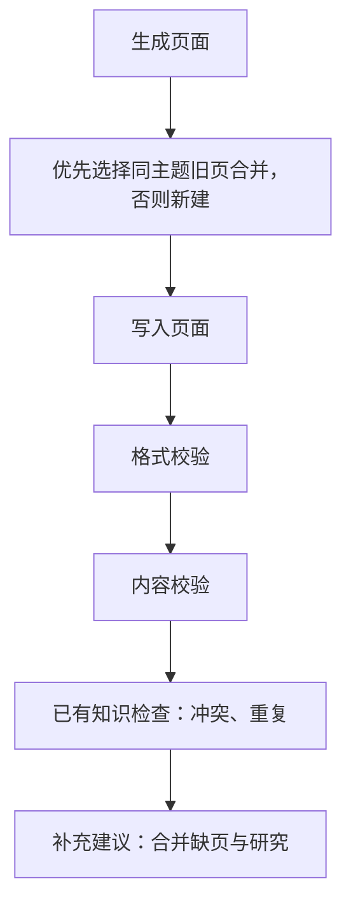

# 入库合并与审阅流程简化设计

日期：2026-10-29  
状态：已按用户指示实施；实现与验证边界见 [实施记录](入库合并与审阅流程简化实施记录-20261029.md)。

## 1. 目标与现状

减少人工处理合并、格式、重复和可直接补回的内容问题。AI 能依据已有材料解决的立即处理；事实冲突、必要的知识补充以及自动处理失败的问题交人工。

本次读取「元数据-LLM-WIKI」得到 141 条当前有效未解决事项，不含历史事项：

| 类型 | 数量 | 主要问题 |
|---|---:|---|
| 合并问题 | 12 | 10 条目标不明确，2 条候选判断协议不完整；处理记录均为保留候选、另存新页，不能直接证明内容错误 |
| 格式校验 | 0 | 仍需保留确定性校验能力 |
| 内容校验 | 19 | 应保留关键事实检查，但存在同一事实重复报告、仅凭本批未找到就要求人工核实的情况 |
| 内容冲突 | 1 | 保留人工判断 |
| 实质重复 | 5 | 适合 AI 整理，不默认要求人工选择合并方式 |
| 缺页建议、研究建议 | 32、72 | 同一未知分别报缺页和待验证，检查范围过宽 |

以上是事项分类统计，不代表每条都已核实为真实问题，也不是改造后的效果承诺。

本方案拟替代 `plans/审阅重要程度与自动修复.md` 中“所有修改均由人工处理”的策略，并调整既有入库审阅设计中的冲突条款。本次按此方案调整代码，旧设计保留历史说明，以本方案与实施记录为准。

## 2. 最终流程

合并属于生成入库阶段，不再作为校验步骤。不再设置独立的“本轮互查”。写入后保留四项检查，格式校验和内容校验分别执行、分别记录结果。

需要自动处理的步骤统一遵守：发现问题 → 自动修复一轮 → 复查受影响结果 → 通过则结束，失败则记录原因转人工。某项失败不要求整份来源重新生成，不阻止其他不依赖该项成功的检查继续执行。

## 3. 生成入库阶段：优先合并

合并判断依据是完整正文的主题和主要用途，不以标题、关键词、目录或类型标签单独决定。

| 场景 | 处理 |
|---|---|
| 同一主题，新内容是步骤、条件、例外或版本差异的补充 | 优先合并到旧页 |
| 多个候选都适合承载 | AI 选择主题和主要用途最匹配的一个，不因候选不唯一直接生成合并待办 |
| 没有合适承载页，或合并必须改变旧页主题、混淆用途 | 独立建页，属于正常完成 |
| 读取完整候选后仍无法合理确定目标 | 明确选择不合并并保存新页，记录原因，不强行合并 |
| 合并执行或结果校验出错 | 允许自动修复一轮；仍失败则保留旧页和完整新稿，记录原因交人工 |

合并应保留独有有效信息、必要条件、例外、来源和有效引用。非关键背景、重复解释和非必要举例允许精简，不再要求无差别保留每句话。

事实不同不代表主题不同。合并时保留双方说法及适用条件，不自行裁定哪方正确，后续交冲突检查判断。正常新建、主动不合并和成功合并只记处理日志；实际失败才进入审阅。

示例：两篇“元数据缓存清理方法”优先合并；“缓存运行机制”和“某工单排查过程”可以独立存在。目标是复用合适页面，不是压低页面数量。

## 4. 写入后的四项检查

### 4.1 格式校验

- 检查 YAML、必填字段、类型与目录、来源、相关链接及项目结构约束；程序能确定的问题优先直接规范化，必要时调用 AI。
- 只修结构和格式，不借机重写事实或补充业务结论。
- 修复后复查格式；通过后仅保留修复记录，仍失败则以格式问题转人工。

### 4.2 内容校验

- 来源原文对照本次最终实际写入结果，检查关键事实遗漏、原意改变和无依据的确定性结论。涉及合并时，同时核对被修改旧页的关键独有内容是否保留，不另设覆盖前后互查步骤。
- “关键”的标准：省略后会改变结论、影响理解或使用，或丢失必要条件与例外。按项目目的不必收录的内容允许舍弃，不要求逐条搬运所有表格、代码或举例。
- 内容已在其他承载页保留、同义改写或合理去重，不判遗漏。发布遗漏前先核对本次完整写入结果，必要时定向读取已有相关页；仅凭本批未找到，不能发布确定性遗漏。
- 已有材料能支持的遗漏、失真立即修复；不能凭常识编造参数、接口、SQL、版本或事实。材料不足则不强行修复，记录原因交人工。
- 复查修复点，并确认受影响页面格式、关键内容仍有效；通过后只保留修复记录。

### 4.3 已有知识检查

对本次页面与检索所得相关正文，检查事实冲突和实质重复。复用现有检索，不新增独立的本轮页面全配对检查。

| 发现 | 处理 |
|---|---|
| 同一对象、版本和条件下存在不相容主张 | 保留双方证据，交人工判断，不自动统一说法 |
| 整页重复且没有独立用途 | AI 归并内容，并处理受影响的来源与链接 |
| 局部重复，页面其余内容各有用途 | AI 精简重复部分或建立引用，保留独有内容，不强求整页合并 |
| 重复部分同时存在事实分歧 | 按冲突交人工，不通过去重决定事实取舍 |

去掉“本轮互查”独立调度、检查点和待办发布；统一知识检查读取的相关知识可包含本轮已经落盘的其他页面，不再按页面来源另跑一次检查。检索有界，不能声称穷尽所有页面关系。

重复整理只执行一轮。复查应确认重复已处理、独有关键内容未丢失、受影响引用有效。仍失败则保留原因转人工；不重新触发整套审阅或递归整理其他主题。

### 4.4 补充建议

缺页建议和研究建议合并为一次“知识补充建议”检查，对知识完整性要求宽松，缩小主动发现范围。

- 只报告直接影响当前主题理解或使用、已有材料无法回答的重要问题；同一未知只生成一条建议。
- 不因缺源码验证、未提供返回字段、版本范围或每个关联概念缺独立页面，就例行生成待办。已有章节能够承载时，不强求成页。
- 页面已明确标为未知、规划或待验证，且没有新的关键影响证据时，不反复生成同一建议。
- 来源本来有但转换丢失，归内容校验；来源本来没有且确实值得补充，才归本项。
- 建议交人工决定是否继续补资料或研究，不自动生成缺乏依据的页面。

## 5. 自动修复一轮的约定

一轮指针对本阶段已发现的问题生成一次修复方案、应用一次，并执行一次针对性复查。方案可同时修改必要的多个页面；复查可以包含程序校验和模型判断，但不能再生成第二版修复稿。

| 结果 | 后续行为 |
|---|---|
| 修复并复查通过 | 保留修改差异和原因，不占人工待审数量 |
| 无法生成有效修复稿、写入失败、复查失败或复查无法完成 | 保留能确认的实际状态，记录失败原因及未解决问题，转人工审阅 |
| 涉及重要档案，既有规则要求修改审核 | 沿用已有候选稿审核；批准前不改原文，批准后复查，不再自动修复第二轮 |
| 写入前发现页面已被其他操作修改 | 不覆盖新版本，记录版本变化原因并转人工 |
| 应用重启或普通重新审阅 | 核实持久记录和实际页面，不自动重放修复，不重新获得同一问题的修复额度 |

修复次数与阶段、输入版本和问题身份关联并持久化；不得仅因标题改写、检查分段、重新检索或人工点击重新审阅而清零。同一问题交人工后，不在本次任务中再次自动处理；人工明确要求重新修复时另行发起。

所有修改沿用现有快照、版本核对、重要档案保护与来源追溯能力。提交后的复查失败不盲目覆盖回旧版；保留实际修改及前后快照供人工处理。旧修复记录只作历史兼容，不能因升级自动应用。

## 6. 待审阅内容与兼容

人工待审阅保留三类：事实冲突、必要的知识补充建议、自动处理失败。失败卡片沿用格式、内容、重复或合并等原问题类型，至少说明问题、已有证据、尝试的修改、失败原因和当前页面是否已经变化。

合并成功或主动独立建页不产生合并待办；格式、内容、重复修复成功不产生人工待办。知识补充建议沿用非重要事项展示；失败与冲突进入重要事项。检查未完成与检查通过分别记录，执行失败不能冒充内容结论。

优先兼容现有 Review 数据结构：新补充建议统一采用 `suggestion` 并展示为“知识补充建议”；历史 `missing-page`、`suggestion` 仍可读取，不为展示合并重写旧 ID。沿用人工已处理、忽略和历史证据状态，不批量标记旧问题已解决。

同一事实在不同分段被发现时，合并为一个事项并补充证据。历史事项保持可查；只有人工明确发起重新审阅时，才按新规则检查、尝试允许的修复并更新当前结果。此前已消耗修复额度或已转人工的问题仍遵守停止规则。

## 7. 实现调整范围

| 位置 | 调整职责 |
|---|---|
| `src/lib/ingest-page-reuse.ts`、`page-merge.ts`、`ingest.ts` | 优先选择合适旧页；多个候选不直接当失败；主动不合并正常完成，真实合并失败执行一轮修复 |
| `src/lib/ingest-review.ts` | 移除合并事件直接发布及独立本轮互查；串联四项检查、一次修复与复查 |
| `src/lib/ingest-acceptance.ts` | 保持格式、内容分开；关键性判断、遗漏承载核实、内容保真与定向复查 |
| `src/lib/ingest-review-repair.ts`、`ingest-run.ts` | 扩展为有持久次数和实际提交记录的一轮修复；保留旧记录兼容，不恢复旧自动任务 |
| `src/lib/ingest-review-batches.ts`、`ingest-review-queue.ts` | 复用检索及队列；修复后失效受影响检查点，重启和重试不重放已消耗修复 |
| `src/lib/ingest-prompts/`、`ingest-prompts.ts` | 同步合并、格式、关键内容、重复整理和补充建议规则；项目自定义规则提供差异迁移，不静默覆盖 |
| `review-priority.ts`、`review-view.tsx`、导入过程界面、API/MCP | 修复成功仅展示记录；失败说明原因；合并补充建议展示，保留历史类型和人工状态 |

复用当前入库记录、后台任务、检索、文件历史和审阅界面，不新建另一套修复队列或工作流。设计通过后，再同步旧设计文档与实际行为说明。

## 8. 验收场景

| 输入场景 | 预期结果 |
|---|---|
| 多个候选中存在合适旧页 | 选择一个合并，独有关键内容保留，不生成目标不明确待办 |
| 候选仅相关、主要用途不同 | 正常新建，记录不合并原因，不要求人工选目标 |
| 格式错误、关键事实漏写或原意失真 | 各自执行一轮修复；复查通过后无人工待办 |
| 省略非关键背景、事实已在其他承载页保留 | 不报遗漏、不强行扩写 |
| 同一主题存在不相容事实，包括检索命中的本轮页面 | 保存双方证据交人工，不自动裁定 |
| 整页或局部重复 | 按实际重复范围整理，独有内容、来源和有效引用保留 |
| 同一未知可同时描述为缺页和待研究 | 只产生一条必要的知识补充建议；一般信息不完整可以不报 |
| 修复生成、提交或复查失败 | 记录准确原因和实际页面状态，交人工；模型调用记录中没有第二轮修复 |
| 修复后重启、取消恢复或重新审阅 | 不重放已应用的修改、不重置同一问题额度、不撤销人工处理状态 |
| 涉及重要档案或并发修改 | 既有审批与版本保护有效，不覆盖未经批准或已变化的正文 |

效果评估同时关注人工待办数量、误报、关键内容保留和自动修复成功情况；不能以隐藏旧事项或减少卡片数量代替正确性验证。
