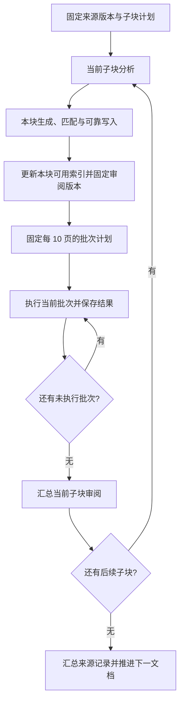

# 长文子块串行入库与分批审阅设计

- 日期：2026-10-29。
- 状态：本地代码已实施并完成相关回归；实现与效果边界见[实施记录](长文子块串行入库与分批审阅实施记录.md)。未安装新的桌面发行包。
- 范围：来源分块后的任务归属、串行执行、每 10 页分批审阅、持久化恢复与导入过程展示。
- 前置方案：[文件入库与后台审阅改造方案](ingest-review-refactor.md)、[此前实施及验收记录](ingest-review-implementation.md)。此前文件描述旧实现，本设计覆盖其中关于入库并发、写入后独立推进下一来源、整轮检索预算和整文任务粒度的约定。

## 1. 已确认的设计决策

1. 暂时沿用现有长文切分规则，不增加模型语义切分，也不强制每个标题成为一个子块。
2. 每个来源子块独立完成分析、生成、匹配、写入和审阅；子块共享原始文档身份，拥有各自的业务运行记录。
3. 一个子块对应一个审阅任务。任务中的知识页每 10 页组成一批，不足 10 页为最后一批。
4. 文档、子块、批次均串行执行，不引入入库并行和审阅并行。
5. 60 秒是每批全库检索的预算，不是整个文档或整个子块的总预算，也不是模型审阅的超时。
6. 每批保存结果和进度，重试沿用仍然有效的已完成结果。
7. 分批以后仍检查跨批页面的冲突、重复，不将批次当作知识之间的隔离范围。
8. 界面采用“来源文档父行 → 子块任务行”，子块内展示批次进度。未分块来源保留单行布局。
9. 历史记录缺少子块归属时继续按整文展示，不根据知识页数或旧摘要反推任务。

本设计把上述决定细化为可实施的默认规则。失败后的推进、检查点失效和状态聚合按下文执行，不再增加需要用户日常选择的批次参数。

## 2. 问题与当前实现

### 2.1 已核对的运行事实

来源 `iuapdocs/13-问题分析/支持问题/202603.md` 的一次导入记录：

- 提取正文 22,532 字符，来源预算 76,800 字符；普通分析正常结束，未触发长文分块。
- 最终写入 17 张页面，写入状态为完整写入。
- 审阅一次提交 17 个页面检索目标，检索耗时 61.226 秒。
- 前两个目标为不完整，后 15 个目标未执行；向量通道记录了请求失败。
- 这次未耗尽候选数或正文字符预算。向量失败与整体时间耗尽均有记录，但现有追踪不能精确分解各通道耗时。

因此，既要支持长文子块成为独立任务，也要对未分块却生成多页的文档实施每 10 页分批；两者解决的粒度不同。

### 2.2 代码连接点

| 位置 | 当前行为 | 设计要求 |
|---|---|---|
| `src/lib/ingest.ts` | 分块分析结果汇总后统一生成页面 | 保留切分算法，将生成、写入和审阅纳入每个逻辑子块的流程 |
| `src/lib/ingest-run.ts` | 一个来源固定版本对应整文运行；保存来源、页面和审阅快照 | 增加文档与子块关联，子块记录复用可靠写入能力 |
| `src/lib/ingest-queue.ts` | 有可配置的工作数量；写入结束后可以推进下一来源 | 统一串行调度，不在当前子块审阅仍运行时推进后续写入 |
| `src/lib/ingest-review-queue.ts` | 独立扫描和执行待审阅记录 | 作为统一调度的待办入口，不再自行与写入队列同时推进 |
| `src/lib/ingest-review.ts` | 整轮生成一个检索请求；按检查种类保存进度 | 固定批次计划，按批和目标保存检索、模型检查结果 |
| `src-tauri/src/commands/search/evidence.rs` | 一个请求的所有目标共享最多 60 秒，顺序执行 | 审阅调用每批最多 10 个目标；返回准确的目标和通道失败原因 |
| `src/components/sources/import-process-view.tsx` | 按运行记录平铺显示与筛选 | 按一次来源导入聚合子块，操作指向真实子块记录 |
| `src/components/sources/import-process-run-row.tsx` | 来源与运行状态在同一行 | 支持父子层级和批次进度，错误按子块归属展示 |

## 3. 任务层级与数量

| 层级 | 含义 | 是否独立调度 |
|---|---|---|
| 来源导入记录 | 原始来源固定版本的一次入库，界面的父行 | 文档按队列顺序串行推进 |
| 逻辑子块 | 固定切分计划中的一段主体原文，负责独立入库 | 按子块序号串行推进 |
| 子块审阅任务 | 核对该子块原文、实际写入页面和相关知识 | 一个子块一个任务，不与下一子块重叠 |
| 审阅批次 | 当前子块最多 10 个不同知识页的固定集合 | 批次按序串行推进 |
| 模型请求 | 一次具体检查、协议修正或冲突复核 | 属于任务内部执行，不按请求数量计算任务数 |

例子：

| 来源分析结果 | 各子块生成页数 | 审阅任务数 | 各任务批次 |
|---|---|---:|---|
| 未分块 | 17 | 1 | 10＋7 |
| 两个子块 | 6、8 | 2 | 6；8 |
| 两个子块 | 23、12 | 2 | 10＋10＋3；10＋2 |

未分块来源在内部使用一个完整原文工作单元，界面不额外显示“子块 1”。应用维护的目录、日志等聚合页面不计入知识页数和十页批次。

## 4. 来源切分与子块输入

### 4.1 保留现有算法

- 来源超出来源预算，或普通分析输出截断时触发分块；存在有效分块断点时按断点恢复。
- 正常目标大小为来源预算的 55%，范围 12,000～60,000 字符。
- 识别 Markdown 标题和空行分段，然后按目标大小装块。
- 段落超过目标大小 1.25 倍时沿句末标点细分；单句超长时按字符兜底。
- 相邻块的重叠上下文为目标大小的 8%，限制在 800～3,000 字符。
- 普通分析输出截断时沿用现有恢复目标；块内输出截断仍可有限细分。

这些是字符估算和结构规则，不保证独立主题，也不新增代码块、表格专用解析。单纯修改提示词不能改变任务划分或预算。

### 4.2 先固定计划，再提交页面

1. 固定原始来源版本及提取正文，计算预算。
2. 未超预算时允许先执行普通分析；正常结束后使用一个完整原文工作单元。
3. 普通分析输出截断时，丢弃截断分析，先产生并保存分块计划，再进入逐块生成写入。此前尚未提交页面。
4. 已知超预算的来源直接保存分块计划，按计划逐块处理。
5. 子块已经开始写入后，不因重试或模型配置变化静默重排原有切分计划。需要重分块时建立新的来源导入记录，旧记录和已写页面保留。

一个逻辑子块在分析时发生恢复细分，细分片段只用于完成该块分析，不增加界面子块或独立审阅任务。先汇总本块完整分析，再生成本块页面，保证用户看到的任务身份稳定。

### 4.3 主体、重叠和摘要的职责

每块保存 `main`、`headingPath`、`overlapBefore` 和进入本块时的前序累计摘要：

- `main` 是本块应生成和核对覆盖的主体原文。
- 重叠原文、标题路径和前序摘要用于解释省略、代词和跨块关联，不单独重复成页，不因为它们未再次写入而报告遗漏。
- 模型输入须显式区分主体与辅助上下文。前序摘要是理解材料；发布事实性问题时仍要引用可定位的原文或页面证据。
- 同一标题跨块、主体需要前文才能理解时，可以回读明确关联的前序原文片段并记录位置；不能仅把摘要当作原文证据。
- 每块分析完成后保存更新摘要；前块分析失败不能跳过后伪造完整摘要继续执行。
- 提示词与程序输入协议共同保留原始来源身份及子块序号，不再将所有子块分析汇总成一次全篇页面生成。

## 5. 串行执行与失败推进



### 5.1 统一调度

统一调度 Module 对外只提供来源入队、暂停／继续、取消、补写和重试审阅等操作；批次构建、有效断点选择及恢复归其内部实现。

- 同一应用内，入库流水线只运行一个当前执行单元，覆盖来源、子块、检索批次和审阅模型调用。
- 仅将写入队列的工作数量设为 1 不足以满足要求：旧审阅队列不能在新来源写入时继续独立执行。
- 保留审阅的持久请求，使切换视图不影响任务；由统一调度认领并等待其本轮执行结束，再推进下一子块。
- 手动重试审阅也通过同一调度，排到当前执行单元之后，不能从按钮直接另起执行。
- 文件预处理中的内部实现不在本次引入并行策略；问答、手工编辑和外部客户端不由本次调度托管，现有文件版本核验继续保留。

### 5.2 默认失败策略

| 情况 | 当前子块 | 后续推进 |
|---|---|---|
| 分析失败、生成失败或写入不完整 | 保留有效输出与补写断点；有实际页面时检查这些页面，来源覆盖检查标记不适用 | 当前来源后续子块等待补写；本轮失败收敛后允许推进下一来源，不无限阻塞全队列 |
| 写入完整，但审阅某批检索或模型检查失败 | 保存已得到的证据和事项，该批部分完成或未完成 | 尝试下一批；所有批次本轮尝试结束后，可以推进下一子块 |
| 某批达到 60 秒 | 保留目标级结果，不把未执行目标当作无命中 | 本轮不循环重跑该批；继续后续批，失败部分由显式重试恢复 |
| 用户暂停、取消或切换项目 | 当前动作在可中断处停止，已写页面和有效结果保留 | 不继续原队列；恢复须走持久请求 |
| 重要档案修改待批准、来源版本冲突或页面写入结果无法核实 | 保留现场，标记待处理或需要恢复 | 不盲目补写本来源；允许其他无阻塞来源按序执行 |

串行表示同一时间只有一个执行单元，不表示一次失败必须无限占用队列。未完成状态一直保留，推进后续任务不能把前面的失败改成成功。

## 6. 每 10 页的批次计划

### 6.1 固定成员

1. 本块写入及必要的页面维护结束后，从业务记录取得实际知识页，按规范化相对路径去重。
2. 将路径按固定的二进制字符串顺序排序，避免受界面语言、目录读取顺序或 `localeCompare` 影响。
3. 按序每 10 页组成一批；0 页且非明确跳过时不能标记为成功，也不创建空批次。
4. 一张页面在同一个子块中即使写入多次，也只按该块最终快照占一个页名额。
5. 批次计划原子保存后开始检查。批次编号用于展示，身份由计划版本及固定成员确定，不能用当前列表下标作为唯一身份。

示例：23 页固定为第 1 批 10 页、第 2 批 10 页、第 3 批 3 页。批内 2 页检索成功后中断，重试仍属于原批次，待处理的 8 页不会重新组成新批次。

### 6.2 批次中的检查

保留现有五类检查职责：合并处理、格式校验、内容校验、本轮冲突、全库相关知识。已有知识部分继续分为冲突、重复、两类缺页和研究建议。

- 合并与格式检查按实际页面、写入事件归入其所在批次。
- 每批全库检索最多提交该批 10 个页面目标，复用统一检索核心的通道开关、融合、正文展开和版本协议。
- 全库知识的模型判断消费当前批页面及实际证据，不为每批重复塞入全部子块页面正文。
- 内容校验覆盖整个子块主体原文。原文可沿用覆盖检查自身的分段方式，保存“原文范围 → 实际相关页面”的覆盖记录；某段在其他批次页面中已被承载时不能报告遗漏。
- 覆盖检查与本轮跨批关系的检查点归在同一个子块审阅任务下，它们不是新的来源子块或独立审阅任务。
- 各步骤区分完成、未完成与不适用；“本次未发现事项”只有在该范围检查确实完成时成立。

### 6.3 跨批、跨块关系

十页是本批主要检查对象的上限，不是允许引用证据的全部页面清单：

1. 子块内的候选关系从该块所有已写页面的固定快照召回，可为当前批页面引入其他批次的关联页证据。
2. 同一候选关系保存双方路径与版本，以稳定的关系身份记录一次判断；不能对每批重复调用相同关系，也不能只检查批内关系。
3. 不逐一对所有全文做平方级模型比较。继续采用有上限的相关候选召回、证据展开及检查范围记录，不宣称穷尽所有页面关系。
4. 全库检索仍排除本子块页面，由本轮检查负责它们；前序子块已经写入的其他页面属于已有知识，可正常召回。
5. 两块写到同一路径时，后块读取前块写后版本作为自己的写前版本。后块审阅保留该前后快照，并核对前块已写内容是否被破坏；必要时读取该页关联的前块原文证据。
6. 前块报告永远保留当时快照，不能被后块写后内容静默替换。当前页面已变化时明确显示历史报告，当前版本结论由后块审阅或显式复核提供。

十页不保证模型请求一定能放入上下文。正文和证据超出模型输入容量时，在原批次内部按实际容量分段执行、保存覆盖范围；不改变十页成员，也不静默截断后宣称整批完成。

## 7. 预算与停止条件

| 预算 | 作用范围 | 设计值／规则 |
|---|---|---|
| 页面数 | 审阅批次 | 最多 10 张不同知识页 |
| 检索时间 | 每批第一次检索或一次显式重试 | 60 秒，批内目标共享；不能退化为每目标 60 秒 |
| 候选与正文 | 每批检索 | 沿用统一核心默认值：320 候选、40,000 正文字符、32 查询；不因重试给同批模型材料无限累加证据 |
| 每目标召回 | 各目标及通道 | 沿用现有 top 5 和 RRF；不修改排序算法或擅自开启关闭的通道 |
| 模型请求 | 每批本轮执行 | 16 次为第一版上限，包含协议修正和冲突复核；不让旧的子块级 16 次限制使后续批永远无法执行 |
| 子块公共检查 | 来源覆盖、跨批候选关系 | 分别使用可持久化的有限检查段，每段最多 16 次；总段数在本轮计划中固定，不能在失败时无限扩展 |
| 协议重试 | 单次模型检查 | 沿用现有最多一次协议修正；失败留下原因，等待显式重试 |
| 输入／输出容量 | 每次模型请求 | 按实际模型配置、完整输入及输出余量计算；放不下时分段或标记未完成 |

每批只自动执行一轮，内部协议重试有界；批次超时、服务失败、用量不足不触发无限自我重排。用户显式重试时可取得新的执行预算，历史累计请求、耗时和失败次数仍保留，不能把统计归零伪装成首次执行。

共享页面缓存、向量索引和关系索引，避免因分批重新构建全库。缓存必须验证版本；不能为了复用而读取过期证据。

时间预算是受控停止目标；同步扫描或不可中断操作可能略超时，界面记录真实耗时，不承诺严格墙钟 60.000 秒。单页反复耗尽批预算时明确列为未完成，不自动改变用户确定的十页分组，也不承诺仅靠分批就一定完成。

## 8. 持久化结构与恢复

### 8.1 文档与子块身份

新增文档级记录，子块复用并扩展现有 `IngestRun`，不在父记录重复存一套子块页面及事项状态：

```text
.llm-wiki/
  ingest-documents/<documentRunId>/
    source.json              原始固定正文、原始版本与提取规则身份
    manifest.json            来源身份、切分计划、子块身份及运行引用
  ingest-runs/<runId>/
    source.json              本块主体原文及可定位范围
    manifest.json            写入意图、页面快照、审阅计划与批次检查点
```

| 记录 | 主要字段与约束 |
|---|---|
| 文档记录 | `documentRunId`、原始 `sourceIdentity/sourcePath/sourceRevision`、切分规则版本、固定子块列表、创建时间、归档／取消信息 |
| 子块计划 | `chunkId/index/total`、标题路径、主体指纹、原文定位、重叠上下文、子块 `runId`；序号只是展示信息 |
| 子块运行 | 原字段加 `documentRunId/chunkId`；原始来源版本与主体版本明确分开，不能混用来源身份和子块正文指纹 |
| 审阅计划 | 子块写入版本、规则／模型／通道配置身份、固定批次成员、公共检查段、覆盖范围 |
| 批次记录 | `batchId/index/pageRefs`、检索目标状态、实际证据、分项模型结果、事项、执行统计与错误 |

原文定位采用固定规范化正文及偏移映射，区分 UTF-16 偏移和行号；现有拆段会规范化空白，不能仅用子块正文 `indexOf` 猜测重复段落的位置。原始文件修订指纹、规范化正文指纹和模型输出指纹分别记录。

`beginIngestRun` 的恢复匹配必须包含文档运行和子块身份；只匹配原始文件名或子块正文指纹，可能错误合并同一来源中内容相同的两个子块。缓存、分析断点、生成断点也必须带子块身份和对应规则版本。

业务记录使用原子写。父记录先持久化子块身份，再以该身份幂等创建子块记录；子块创建后、父引用保存前中断时，恢复扫描同一 `documentRunId/chunkId` 找回记录，不能再次生成一个业务任务。父行状态从子块记录聚合，避免多文件状态双写不一致。

### 8.2 目标级检查点

批次保存的不只是一个成功／失败标记：

- 每个检索目标及每个启用通道的状态、原因、证据 ID、使用量和真实耗时。
- 已完成的模型检查及其实际消费的目标、证据、页面版本。
- 内容覆盖与跨批关系的检查范围和版本。
- 已发布事项身份及人工处理状态。

本批前 2 页已完成检索、后 8 页未执行时，显式重试优先复用有效结果，继续未完成目标；某页只有向量通道失败时可重试未完成通道并重新融合，前提是配置、页面和语料版本仍适用。恢复不能将 `partial/not_run` 当作 `no_match`。

有效性包括子块主体版本、写入版本、规则、通道及模型身份、实际证据版本和语料变更标记。证据原页未变化，并不意味着全库没有新增相关页面；继续旧检索结果须核对语料变更标记。标记变化时重新检索受影响范围，不能声称复用了当前全库的无命中结论。

### 8.3 补写、重试和版本变化

- 重试审阅不重新分析或写入页面，也不删除仍有效的已完成批次。
- 本块补写增加知识页或改变已有页面时，完成写入后生成新审阅计划；旧批次报告保留为历史。成员及消费版本相同的检查可复用，其余重新执行。
- 审阅规则、模型或通道配置变化时，保留历史统计与报告，按依赖范围失效检查点。
- 手工编辑或其他入口改变已消费正文时，发布前回读核验；失效结果标为历史或需要复核，不自动覆盖用户正文。
- 写后登记中断仍使用现有可靠写入恢复机制，只核实和补登记，不重复提交已确认的页面。
- 取消、暂停、用量不足和项目切换都保存当前进度，禁止取消后的晚到响应发布为当前任务结果。
- 同一来源的新修订形成新的文档运行，不沿用旧文档的未完成子块作为新版本结论。

## 9. 状态、事项与父行汇总

### 9.1 状态职责

- 写入状态、自动审阅状态和人工待办分别保存与展示；有待办不代表自动审阅尚未执行完成。
- 自动审阅“完成”要求所有适用批次及公共检查段完成；部分检查有有效结果但仍有失败时为“部分完成”，没有足够有效结果时为“审阅未完成”。
- 某批全库检索部分完成，即使随后模型返回正常，也不能把该批标记为完整检查。
- 沿用重要／非重要待办规则：缺页与研究建议属于非重要待办；不能把检索不完整降为非重要检查失败。
- 人工忽略并归档只是处理决定，保留原失败和检查范围，不能改写为审阅成功。

### 9.2 汇总与去重

- 父行写入页数按实际路径去重；各子块页数按各自实际页面计数。同一路径由两块更新时，子块页数之和可以大于父行唯一页数。
- 父行自动检查进度为已完成子块数／总子块数，并单独提示有多少失败或未完成子块。
- 当前正在执行的子块和批次优先显示；所有子块本轮尝试结束但仍有未完成项时，父行进入“需审阅”或“写入失败”，不能永久显示“进行中”。
- 父行待办按事项稳定身份去重，同时保留事项与多个子块的关联；不能用标题相同作为去重依据。
- 后续子块改变共享页面时，旧事项保留历史身份；人工确认、隐藏、归档状态继续沿用现有版本化合并规则。
- 批次已经得到的有效事项随检查点幂等发布，让已完成部分可以查看；子块最后汇总不能再重复新增。版本过期的事项须显式标为历史。

## 10. 导入过程界面

### 10.1 列表布局

```text
来源 / 导入时间                  写入          自动审阅              人工待办

▾ 202603.md
  iuapdocs/…/支持问题
  导入时间 · 2 个子块 · 完成 1/2

  ├─ 子块 1 · 标题路径            完整写入      审阅完成              3 项待处理
  │                              8 页          1/1 批
  └─ 子块 2 · 标题路径            完整写入      审阅中 · 第 2/3 批    —
                                 23 页         1 批已完成
```

- 父行展示来源、导入时间、整体进度及汇总异常，不重复整套子块错误。
- 子块状态按写入、自动审阅、人工待办三列对齐；标题路径过长时省略并支持查看完整文本。
- 未执行子块显示“等待处理”；当前子块尚在写入时显示“等待写入完成后审阅”，不提前创建虚假的批次进度。
- 批次计划形成后显示批次总数、当前批及完成数；不是只显示“第 2 批”而让用户误以为第 1 批已成功。
- 子块展开后显示每批成员、实际结果、失败目标、检查范围与页面前后快照。
- 默认展开正在执行或需要关注的来源；已完成来源允许折叠。用户手动折叠后，轮询刷新不反复强制展开。
- 未分块来源沿用单行，单行内增加批次进度；旧记录没有批次信息时显示原状态。

### 10.2 计数、搜索与操作

- 顶部筛选和计数按来源导入记录计算，不把两个子块算成两个来源。
- 分类优先级：存在当前执行动作时“进行中”；本轮已结束且有未完成写入时“写入失败”；写入完整但审阅未完成或有重要待办时“需审阅”；重要检查完成且无重要待办时“已完成”；明确无正文时“已跳过”。继续保留非重要待办说明。
- 搜索匹配来源、子块标题或生成页面时显示父行及其子块上下文，不将子块拆成顶层孤立结果。
- 父行提供整个来源日志、取消后续执行、继续未完成工作和来源归档。归档前回读所有子块状态，不归档仍执行中的来源。
- 子块提供其日志范围、补写、重试审阅和查看事项；重试审阅优先恢复该块未完成批次及公共检查段。
- 子块日志实际仍可保存在同一来源 JSONL，按文档、子块、运行与批次身份筛选；导出不能漏掉重试和历史关联。
- 当前批次状态和实际待办分别展示，导航跳转携带真实子块运行身份。

### 10.3 错误提示

将重复内部标记归并为中文摘要，同时保留可展开原始详情：

> 子块 2 · 第 2/3 批检索超时：2 页检查不完整，8 页未执行；向量通道请求失败。第 1 批已完成。

摘要包含阶段、批次、完成／不完整／未执行数量及实际通道原因；不连续打印多个 `timeLimit/task-budget`，也不同时重复总错误和同一步骤错误。超时是执行问题，不能被发布成知识内容错误。

## 11. 兼容与实施边界

1. 新来源使用文档与子块记录；历史 `version: 1` 整文运行继续可读、可审阅、可导出。
2. 已有历史任务重新审阅时，可以按实际页面建立十页批次，不重新生成页面，也不伪造其历史来源子块。
3. 只有重新入库才采用新的来源子块流水线；旧分析断点和生成缓存不能未经协议版本检查直接变成新子块任务。
4. 保留旧事项 ID、人工状态、页面快照和原始来源路径；不把内部子块文件冒充新的外部来源文件。
5. 自动上传、来源监控、交互入库和会话保存统一进入串行调度。没有长文分块需求的入口使用单个工作单元，不能各自另建绕过规则的执行链。
6. 不改通用编辑、API 写页的授权和文件语义；现有安全路径、比较写入和版本证据能力继续复用。
7. 不自动重跑历史失败，不静默修改用户提示词或重建向量索引。
8. 不通过提高并发、强制缩短原文或取消失败提示来满足完成率。十页分批本身不保证服务永远在 60 秒内响应。

## 12. 实施顺序与验收

### 12.1 实施顺序

| 阶段 | 修改范围 | 完成标准 |
|---|---|---|
| 1 | 文档／子块身份、来源与计划持久化、旧记录读取 | 两个相同正文子块仍是不同任务；中断恢复不重复创建记录 |
| 2 | 现有切分接入逐块生成与可靠写入，断点／缓存按块隔离 | 两个子块分别成页、分别记录；共享页面顺序合并；不再全篇统一生成 |
| 3 | 统一串行调度与取消／恢复 | 来源、子块、审阅不重叠；手动重试不能绕过调度 |
| 4 | 十页批次、目标检查点、预算与跨批检查 | 23 页为 10＋10＋3，失败只重试有效性不满足的部分 |
| 5 | 父子展示、汇总、筛选、日志与事项导航 | 界面与真实任务一致，不伪造旧子块，不重复计数或提示 |
| 6 | 相关集成回归和真实服务效果评估 | 行为契约通过；实际模型效果与时间记录单独报告 |

新建 Module 只收拢真实职责，不为一个顺序循环额外引入通用工作流框架。共享检索核心继续服务其他入口，审阅的批次调度不应泄漏到问答和普通搜索。

### 12.2 必须验证的输入输出场景

| 场景 | 应验证的结果 |
|---|---|
| 原文低于来源预算、生成 17 页 | 一个任务，两批 10＋7；不创建长文子块 |
| 来源切为两块，分别生成 23、12 页 | 两个子块审阅任务，批次分别为 10＋10＋3 和 10＋2 |
| 来源普通分析截断后转入分块 | 先固定切分计划，再逐块生成；不使用截断分析生成页面 |
| 某逻辑块内部分析再次截断 | 内部恢复细分，不改变已有逻辑子块任务数 |
| 第 1 批超时，第 2 批正常 | 第一批保留失败目标，第二批有独立预算并执行；总体不标记全部完成 |
| 同批 2 个目标已完成、8 个未执行后重试 | 批次成员不变，有效的两个目标不重复执行；配置／语料变化则按规则失效 |
| 第 1 批完成后应用重启 | 从未完成批次和检查段继续，不重新生成或再次写页 |
| 相同正文出现在不同子块 | 记录和断点隔离，不因正文指纹相同合并任务 |
| 第 1 批与第 3 批存在实际冲突或重复 | 候选关系和双方证据能进入检查，结果不依赖两页恰好在同一批 |
| 主体原文在另一批页面中被承载 | 内容覆盖校验不误报遗漏；重叠上下文不要求重复成页 |
| 两块依次更新同一页面 | 后块基于前块版本写入，前后快照可追溯；前块贡献被破坏能被核查 |
| 两块正文与重叠内容包含同一问题 | 按真实证据身份合并事项，人工状态不丢失 |
| 审阅进行时手动触发其他入库或重试 | 进入同一串行顺序，不出现第二个入库流水线执行单元 |
| 人工编辑、配置变化、新增知识页 | 相关检查点失效或明确成为历史，不冒充当前版本完成 |
| 暂停、取消、切换项目与迟到响应 | 已写结果保留；取消后不继续提交事项；恢复位置准确 |
| 模型上下文不足或请求数达到上限 | 保留真实未检查范围，不截尾伪装完成，不无限重试 |
| 历史记录没有子块字段 | 整文单行展示，原日志、事项和复核继续可用 |
| 父子显示与筛选 | 按来源计数；共享路径与共享事项不重复汇总；刷新不覆盖手动折叠 |

用可控检索响应、模型响应、时钟和真实临时文件验证任务与恢复契约；不将测试耦合到切分内部辅助函数或界面 CSS 类名。真实 Ollama／模型测试只用于记录耗时、召回与判断效果，不用一次成功承诺批次必定能在 60 秒内完成。

本设计已在本地代码中实施。相关回归、真实服务评估与适用边界见[实施记录](长文子块串行入库与分批审阅实施记录.md)；设计说明不替代实际模型效果与桌面发行包验证。
